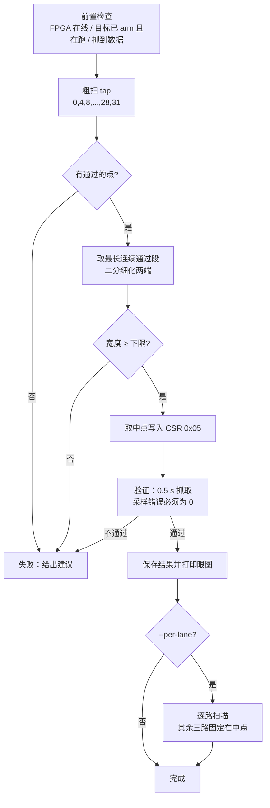

# trace 采样点自动校准设计
日期：2026-11-03
状态：设计稿（未实现，未上板验证）

本文给出 `cortrace fpga` 的采样点自动校准方案：自动扫 IDELAY tap，找出能干净解码的
窗口，取中点写回 FPGA。动机来自 i.MX RT1176 的上板：它的并口数据与时钟同沿变化，
手工扫 tap 费时，而且不同频率的最佳点不同。

---

## 1. 问题

### 1.1 采样点在哪里

`trace_capture_a7` 用 IDDR 在 TRACECLK 的上升沿和下降沿各采一个半字节（`Q1`、`Q2`），
每个 TRACECLK 周期合成一个字节送入后级。数据脚前面有 IDELAYE2，tap 范围 0 到 31，
每档约 78 ps，最大约 2.4 ns，运行时通过 CSR 0x05（四路同值）和 0x06（单路）修改。

采样是否可靠取决于"数据跳变相对采样沿"的位置。两类目标板实测如下：

| 目标 | 数据相对时钟 | 说明 |
|------|--------------|------|
| STM32H743 | 中心对齐，跳变离两个沿各约 4 ns | tap 取 2 附近 |
| i.MX RT1176（EVK） | 沿对齐，数据在时钟沿之后 1.4 到 3 ns 才变 | 采样点正好落在跳变带里 |

RT1176 的示波器读数（33 MHz，时钟脚用快转换）：时钟周期 30.3 ns；D3 上升沿在时钟上升沿
之后 1.35 到 1.85 ns，下降沿在时钟下降沿之后约 2.9 ns。数据是双沿的，一位只有 15 ns。

### 1.2 现在怎么调

手工：`set-tap N`，抓一小段，用 `cortrace-decode` 看 `stream health`，换下一个 N。
32 个点要几分钟，而且每换一个目标板、时钟频率或焊盘设置都要重来。

### 1.3 RT1176 上的扫描数据

这些数据决定了本文的判据设计（cachecliff 负载，每点抓 0.05 到 0.15 s）。

时钟脚快转换（焊盘 0x3），33 MHz，timing 档：

| tap | 现象 |
|-----|------|
| 0 到 11 | 解不出任何 ETM 包，但同步帧正常 |
| 12 到 31 | 能解，但 `lost-sync`、`addr-nacc` 随 tap 增大 |

时钟脚慢转换（焊盘 0x2），其它频率：

| 引脚时钟 | tap | slice 数 | lost-sync | resync(TraceOn) | addr-nacc |
|---------|-----|---------|-----------|-----------------|-----------|
| 33 MHz | 0 到 31 全部 | 约 29000（coverage 档） | 0 | 0 | 0 |
| 44 MHz | 0 | 938 | 131 | 3 | 49 |
| 44 MHz | 6 | 9048 | 34 | 14 | 48 |
| 44 MHz | 12 | 9874 | 7 | 7 | 0 |
| 44 MHz | 18 | 9730 | 10 | 10 | 0 |
| 44 MHz | 24 | 8972 | 29 | 7 | 44 |
| 44 MHz | 31 | 7542 | 52 | 8 | 228 |
| 53 MHz | 31（数据脚 0x2） | 9276 | 7 | 2 | 59 |
| 66 MHz | 0 到 31 | 0 | 0 | 0 | 0 |

从中得到三条结论：

1. **窗口随频率收窄**：33 MHz 整个 tap 范围都行；44 MHz 只有 tap 12 到 18 附近（6 和 24 已失败）；
   53 MHz 找不到干净点；66 MHz 什么都解不出。
2. **带宽溢出和采样错误要分开**：采样好但 ETM 数据量超过端口带宽时，`lost-sync` 等于
   `resync(TraceOn)`，`addr-nacc` 为 0（例如 33 MHz timing 档的 2583 与 2583）。采样不好时
   `lost-sync` 远大于 `resync(TraceOn)`，且 `addr-nacc` 大于 0。
3. **有一种失败看不到错误计数**：66 MHz 以及 33 MHz 快转换的 tap 0 到 11，解码器只看到同步帧，
   `lost-sync` 为 0，slice 数为 0。只看错误计数会把它们误判为"干净"。

---

## 2. 目标与非目标

目标：
- 一条命令完成校准，在 2 分钟内给出 tap（或每路 tap），写入 FPGA，并报告窗口宽度。
- 窗口太窄或不存在时明确失败，并给出下一步建议，不静默选一个"最不坏"的点。
- 不依赖目标板型号，不需要改比特流（当前比特流 v1.1.0 已有 CSR 0x05/0x06）。
- 旋钮可替换：以后加 MMCM 精细移相，算法不变。

非目标：
- 不在 FPGA 内做硬件自校准（原因见 §7）。
- 不处理带宽溢出（那是 ETM 配置和端口频率的问题，只报告）。
- 本文不设计 MMCM 移相本身。

---

## 3. 总体流程



### 3.1 前置条件

- 目标按平台文件 `arm` 过，且正在跑一段**ETM 流量足够、内容不断变化**的程序。小循环不行：
  ETM 输出几乎是重复的原子，采样错误不容易暴露。cachecliff 的测量阶段符合要求。
- 校准期间保持 ETM 配置不变。timing 档和 coverage 档都可以，但用于校准的档位应与以后
  抓取的档位一致。
- 不用 TPIU 内置测试图案（AA/55）。工作区的 AGENT.md 要求用真实高熵流校准、不要用 AA/55。
  空闲状态也不行：此时 TPIU 只发 `7F FF` 填充，四路里只有 D3 在翻转，D0 到 D2 恒为 1，
  无法校准这三路。

### 3.2 一个点怎么测

1. `write_csr(0x05, tap)`，这会重新武装抓取。
2. `cortrace-grab` 抓 `--secs`（默认 0.1 s）。
3. `cortrace-decode --raw` 解码，读 `stream health` 与 `slice events` 两行。
4. 计算得分（§4）。

单点约 5 到 10 s，主要花在解码。32 个点全扫要几分钟，所以用粗扫加二分，约 15 个点。

---

## 4. 判据

每个点得到：

- `E = max(0, lost-sync − resync(TraceOn)) + addr-nacc`：采样错误计数。
  依据 §1.3 第 2 条：溢出造成的 lost-sync 都伴随同数量的 resync(TraceOn)。
- `N = slice events`：解出的事件数。依据 §1.3 第 3 条，用来排除"没有错误但也没有数据"。

一个点**通过**，当且仅当：

- `E ≤ ε`，ε 默认 0；对高负载目标允许 `--max-errors` 放宽。
- `N ≥ 0.5 × N_ref`，其中 `N_ref` 是粗扫所有点里 `N` 的中位数。窗口内的点 `N` 应相近
  （表 44 MHz：9048 到 9874），窗口外要么骤降（938、0）要么因错误变少。

这个判据靠 `cortrace-decode` 现有输出实现，不改解码器。局限：
- 它依赖目标在校准期间流量稳定；`N` 随负载变化时，`N_ref` 取中位数而不是最大值，
  以免被一次高峰带偏。
- 解码摘要的行名是解码器的输出格式，改格式会让校准失效，需要在测试里锁定（§8）。

可选的快速预筛（后续优化，需验证）：`cortrace-decode` 里已有 `count_etmv4_async`，
ETM 每 4 KiB 发一次 A-sync（`TRCSYNCPR` 设为 0xC）。一次抓取里 A-sync 的数量应接近
`字节数 / 4096`，采样错误会让它明显变少。它比完整解码快，可用来粗扫，最终判定仍用上面的判据。

---

## 5. 窗口搜索

输入：粗扫得到的每个点通过与否。输出：窗口 `[lo, hi]`、中点、宽度。

1. 取粗扫中**最长的连续通过段**（连续按粗扫步长计）。
2. 向两端各做一次二分，找到边界 tap（把相邻的"通过/失败"点之间收缩到 1 档）。
3. 窗口宽度 `W = hi − lo + 1`（单位 tap）。中点 `(lo + hi) / 2` 向下取整。
4. 宽度下限默认 `W ≥ 6`（约 0.47 ns）。小于它，温度和电压漂移就可能吃掉余量，判失败。
   这个值是估计，需要按 §8 的重复性测试调整。

特殊情况：

- 通过段碰到 0 或 31：窗口被 tap 范围截断，真实中点不一定在范围内。此时报告
  "窗口贴边"，仍取中点，但提示需要更大的移相范围（比如 33 MHz 的情况是整段通过，
  不需要精确）。
- 粗扫全通过：窗口宽度记为 32，取 16，不再细化。
- 多个不连续的通过段：取最长的一段，并打印警告。这通常说明判据噪声大或负载不稳。

### 5.1 眼图输出

```text
tap  0                              31
     xxxxxxxxxxxx#######xxxxxxxxxxxxx
     window 12..18 (7 taps, 0.55 ns), chosen 15
```

`#` 通过，`x` 失败，`.` 未测（二分没有走到的点）。

---

## 6. 接口与落地位置

### 6.1 命令行

在现有 `cortrace fpga ctrl` 下增加子命令：

```text
cortrace fpga ctrl calibrate --elf <ELF> [--secs 0.1] [--coarse-step 4]
                             [--max-errors 0] [--min-width 6]
                             [--per-lane] [--no-apply] [--save PATH]
```

- `--elf`：解码需要，沿用 `cortrace capture` 的同名参数。
- `--no-apply`：只测不写 CSR。
- 默认写入 `~/.config/cortrace/calibration/<platform>.json`（可由环境变量覆盖），
  内容为 tap（或四路 tap）、窗口、测得的引脚时钟（由抓取速率估计）和时间。
  这个文件只是记录，**不自动应用**：后续会话不会静默改写 tap。
- 退出码：0 成功；2 窗口太窄；3 没有通过的点；1 其它错误。

实现位置：`cortrace/python/cortrace/fpga/calibrate.py`，复用 `ctrl.write_csr` 与
`capture.grab` 的抓取封装。窗口搜索写成不依赖硬件的纯函数，便于单测。

### 6.2 旋钮抽象

```python
class SamplingKnob:
    """A runtime setting that moves the sampling point."""
    def values(self): ...          # ordered list of settings
    def apply(self, value): ...    # write the CSR(s)
    circular = False               # True for a phase knob that wraps around
```

今天只有 `IdelayKnob`（0 到 31，不循环）。以后若加 MMCM 精细移相，可以实现一个循环旋钮，
窗口搜索改成在环上找最长通过弧。流程图不变。

### 6.3 逐路校准

CSR 0x06 允许单路设 tap。`--per-lane` 在整体中点确定后，逐路扫描，其余三路固定在中点，
每路得到自己的窗口和中点。是否需要它取决于各路的偏斜：

- 用 LA 或示波器量 D0 到 D3 相对时钟的偏移，若差异小于窗口宽度的一半，就不需要。
- 现有数据只量过 D3，未量其它路。

所以默认关闭，先收集数据再决定。

---

## 7. 为什么不在 FPGA 里做

Xilinx 的动态相位对齐（DPA）通常靠已知训练序列做硬件自校准。这里不适合：

- 并口 TPIU 的流是格式化帧加 ETM 数据，没有适合各路的已知序列。空闲只翻转 D3，
  测试图案会误导（§3.1）。
- 判据需要解码层信息（`addr-nacc`、事件数），这些只有主机有。

FPGA 内可以做的是**持续监控**：统计同步帧里违规字节数，给主机一个低成本的漂移告警，
以后需要时再设计，本文不含。

---

## 8. 测试计划

单元测试（无硬件，进 CI）：
- 窗口搜索：单段窗口、窗口贴边、全通过、全失败、多个通过段、噪声点（孤立的失败）。
- 判据：用 §1.3 的表作为用例，E、N 的计算和通过判定必须与表一致（44 MHz tap 12、18 通过，
  0、6、24、31 失败；66 MHz 全部失败）。
- 摘要解析：给定 `cortrace-decode` 的输出样本，断言解析出 `lost-sync`、`resync(TraceOn)`、
  `addr-nacc`、`slice events`。解码器输出格式变化时这个测试会先失败。

上板验证：

| 项目 | 期望 |
|------|------|
| STM32H743，原有接线 | 窗口包含 tap 2，宽度不小于现有手工结论 |
| RT1176 33 MHz | 整段通过，窗口贴边提示 |
| RT1176 44 MHz | 窗口约 12 到 18，中点 15 |
| RT1176 53 MHz | 报告失败（现有数据没有干净点） |
| RT1176 66 MHz | 报告"没有通过的点" |
| 重复性 | 同一设置连续 5 次，中点波动不超过 2 档 |
| 负载变化 | cachecliff 与 LVGL 两种负载，中点相差不超过 2 档 |
| 故意破坏 | 把 RT1176 时钟脚改回快转换，窗口应消失或移位 |

---

## 9. 风险与未决问题

- **判据的稳健性**：ε=0 在高负载、ETM 偶发错误时可能过严；`N_ref` 取中位数的假设要用
  真实数据检验。
- **窗口宽度下限 6 档**只是估计，没有温度或电压数据支撑。
- **时间**：解码占大头。若 A-sync 预筛有效，整体可降到 1 分钟内。
- **引脚时钟的获取**：当前比特流（v1.1.0）没有 pin monitors，不能读 TRACECLK 频率。
  先用抓取速率估计（FPGA 每个 TRACECLK 周期送一个字节，44 MHz 时测得 44.0 MB/s，
  吞吐受限时会低估）。
- **只量了 D3**：各路偏斜未知，`--per-lane` 是否必要待数据。
- **53 MHz 以上**：IDELAY 的 2.4 ns 不够。需要另行设计 MMCM 精细移相，或过采样加数字选相
  （仓库里已有 `la_ddr_writer` 的 200/400 MSPS 路径）。这两个方向的取舍不在本文。
